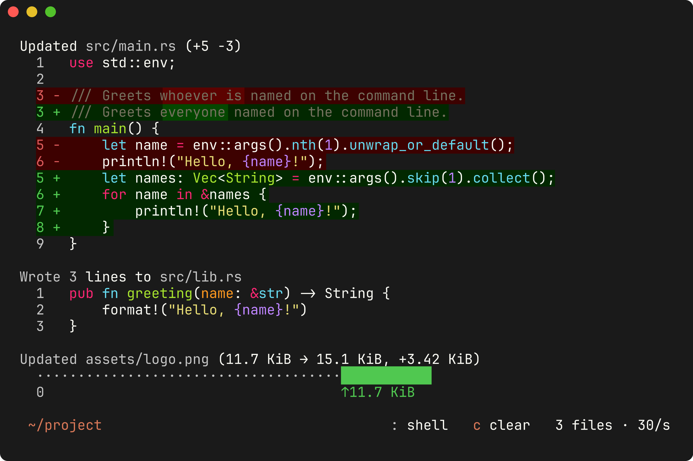
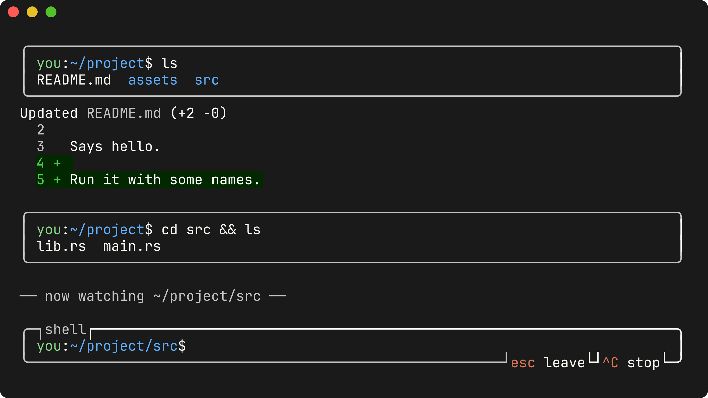

# difftop

Watch a folder and see every file change rise up your terminal as a live,
syntax-highlighted diff.

difftop is less a review tool and more an ambient display: keep it open in
a side pane of a tiling window manager and it shows what's happening in your
projects. It doesn't care who made a change, whether that's you, your
editor, a formatter or five coding agents at once.



New changes enter at the bottom and push older ones up. Brightness means
one thing: added and removed lines are bright, and the unchanged lines
around them are dim. Changed lines also sit on a green or red background
that leaves their syntax colors alone, and every line shows its line number
(`--no-change-background` and `--no-line-numbers` turn those off). Changes that arrive in a burst are queued and
released at a steady pace, so they scroll in instead of appearing all at once.

## Install

difftop runs on Linux (x86_64 and arm64).

```bash
curl -fsSL https://raw.githubusercontent.com/Seenko/difftop/main/install.sh | sh
```

[The script](install.sh) downloads the latest release binary, checks its
checksum, and puts it in `~/.local/bin`. No sudo is needed. Set
`DIFFTOP_DIR` to install somewhere else.

You can also download the binary yourself. Every
[release](https://github.com/Seenko/difftop/releases) has
`difftop-linux-x86_64` and `difftop-linux-aarch64`, statically linked so
they run on any distro. Or build from source with a Rust toolchain:

```bash
cargo install --git https://github.com/Seenko/difftop
```

## Use

```bash
difftop                   # watch the current folder
difftop ~ /etc            # watch several folders
difftop --theme dracula   # pick a theme
difftop --help            # everything else
```

| Key                    | Action                                 |
| ---------------------- | -------------------------------------- |
| `↑` `↓` / mouse wheel  | scroll back through history            |
| `PgUp` `PgDn`          | scroll a page                          |
| `Home` / `End`         | jump to the oldest line / follow again |
| `+` / `-`              | faster / slower                        |
| wheel over the speed   | faster / slower, in finer steps        |
| `c`                    | clear the screen                       |
| `:` or `!`             | open the shell prompt                  |
| `Ctrl-C`               | quit                                   |
| `Ctrl-L`               | redraw the screen                      |
| `Esc` `Esc`            | quit (the first press asks to confirm) |

The status line at the bottom shows what's watched, the two keys you
wouldn't guess (`:` and `c`), and the file count and speed.

You can scroll back at any time. While you're scrolled back, the view stays
put and new changes keep arriving below it. A notice at the bottom shows
how many newer lines there are. Press `End` or click the notice to follow
again. difftop uses the mouse for scrolling, so to select text with the
mouse, hold `Shift` while dragging (most terminals).

What gets watched:

- Folders are watched recursively, and new folders are picked up as they appear.
- `.gitignore` rules are respected. `--no-ignore` turns that off.
- Hidden files and folders are skipped. `--hidden` includes them.
- `.git` is always skipped.
- Binary files and files over 1 MiB can't be diffed, so they show their size
  change instead, e.g. `12.0 KiB → 14.1 KiB  +2.10 KiB`.

### The built-in shell

Press `:` (or `!`) to get a shell prompt without leaving difftop. It's
*your* prompt: difftop asks your shell (bash or zsh) to draw it, so `PS1`,
starship and the like look the way they do in your terminal. Type any
command (`ls`, `git status`, `cargo build`, ...) and its output appears as
it runs, in a box of its own, with file changes flowing around the boxes.
Commands run in your own shell with your aliases, on a real
(pseudo-)terminal the width of difftop, so colors and columns come out the
same as in your terminal.

If a command changes directory (`cd ../other`, `cd src && ls`, `cd -`),
difftop follows. It watches the new folder from then on, and a line in the
feed marks the switch. What's already on screen stays.



- `↑`/`↓` go through earlier commands, and `Tab` completes file and folder
  names. Pasting works.
- `Enter` runs the command and leaves the prompt open for the next one.
  `Esc` closes it.
- `Ctrl-C` stops a running command. If nothing is running, it quits difftop.
- Full-screen and interactive programs (editors, pagers, password prompts)
  don't work here, because difftop doesn't pass your keys on to them. If one
  waits for input, `Ctrl-C` stops it.

## Themes

The default theme is **`ansi`**. It colors everything with your terminal's own
16-color palette, so it matches your shell theme automatically and follows it
live when you switch terminal themes.

To choose a different theme, run `difftop --list-themes` and pass a name with
`--theme`. Case and punctuation don't matter, so `solarized-dark` finds
`Solarized (dark)`. Besides `ansi` you can use:

- **`matrix`**, green CRT phosphor on near-black. Everything is a shade of
  green, removed lines are a dimmer green than added ones, and the screen
  flickers now and then.
- **The themes bundled from [bat]**, for example Dracula, Nord, gruvbox, Catppuccin,
  Solarized, Monokai and OneHalf.
- **Any [base16/base24] scheme.** There are hundreds. To install all of them at once:

  ```bash
  git clone https://github.com/tinted-theming/schemes ~/.config/difftop/themes/tinted
  difftop --theme rose-pine
  ```

- **Any `.tmTheme` file**, the TextMate/Sublime format that bat and delta use.

Theme files dropped anywhere under `~/.config/difftop/themes/` are found by
file name. A theme there with the same name as a bundled one takes priority.
You can also pass a path directly with `--theme path/to/theme.yaml`.

If you use [tinted-shell] or base16-shell to theme your terminal, the
`base16` and `base16-256` themes follow it the same way `ansi` does.

## Updating

Replace the binary, whether by re-running the installer, `cargo install`,
or copying a new build over it. Every running difftop notices within a
couple of seconds and reloads itself into the new version. The history on
screen, where you've scrolled to, the speed, and the folder you `cd`ed
into all carry over. A line in the feed marks the reload.

## Limits

- difftop needs one inotify watch per folder. If you watch a huge tree, you
  may hit `fs.inotify.max_user_watches`. difftop shows a warning in the status
  line when that happens.
- To diff a file's first edit, difftop needs its text from before. It keeps
  up to 16 MiB of text, the most recently modified files first. A file
  outside that shows only its size change the first time it changes, and is
  diffed normally after that. Watching a project takes about 10 MB of
  memory; watching a whole home folder with tens of thousands of files,
  about 50 MB.

## Contributing

Contributions are welcome. [CONTRIBUTING.md](CONTRIBUTING.md) covers setup and
the workflow, and [ARCHITECTURE.md](ARCHITECTURE.md) explains how the code
fits together.

## License

Licensed under either of [Apache License 2.0](LICENSE-APACHE) or
[MIT](LICENSE-MIT), at your option. Unless you explicitly state otherwise,
any contribution you submit for inclusion is dual licensed the same way,
without any additional terms or conditions.

[bat]: https://github.com/sharkdp/bat
[base16/base24]: https://github.com/tinted-theming/home
[tinted-shell]: https://github.com/tinted-theming/tinted-shell
